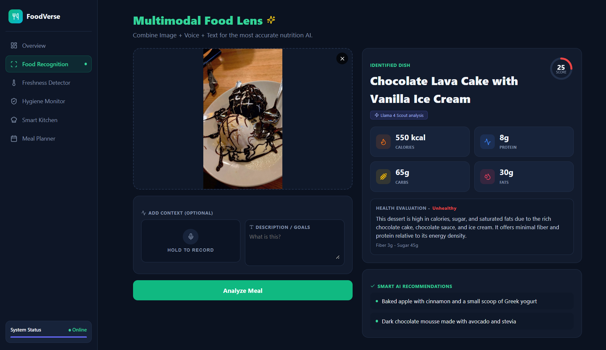
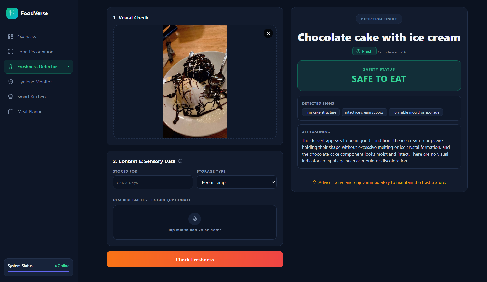
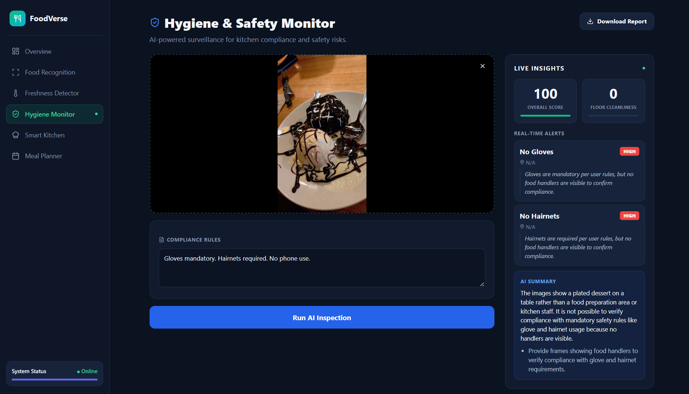
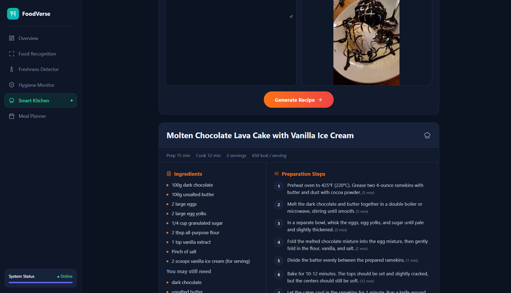
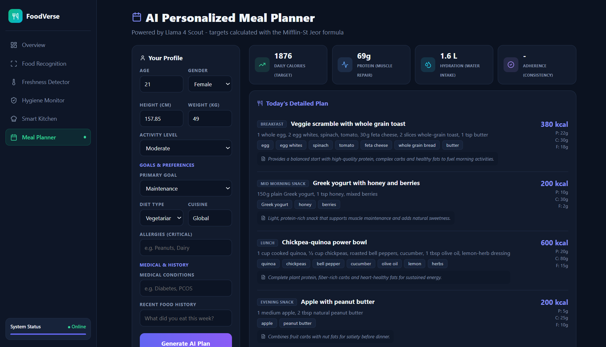

# FoodVerse AI - Multimodal Food Intelligence Agent

AI platform with five modules, built on FastAPI + React and Groq-hosted models (gpt-oss-120b for text, Qwen 3.6 for images):

| Module | What it does |
|---|---|
| Food Recognition | Identifies a dish from photo/voice/text; estimates calories, macros, health score |
| Freshness Detector | Fresh / Moderate / Spoiled with confidence, signs and safety advice |
| Hygiene Monitor | Checks kitchen photos or video for gloves, hairnets, cleanliness; compliance score in code |
| Smart Kitchen | Recipe with ingredients and steps from text or an ingredients photo |
| Meal Planner | Calorie/macro/water targets calculated in code (Mifflin-St Jeor), 5-meal day + weekly overview by AI, allergen check, coach report (adherence only shown when you give eating history) |

## Run it (Windows)
1. Install Python 3.10+, Node.js 18+ and ffmpeg. Get a free key at https://console.groq.com
2. Double-click `run_backend.bat` (first run asks for the Groq key in Notepad; run it again after saving).
3. Double-click `run_frontend.bat`, then open http://localhost:5173
4. API docs: http://localhost:8000/docs
5. Edge-case tests: double-click `run_tests.bat` (backend must be running) -> `test_results.md`

## Sample outputs

Screenshots of each module running on my own test inputs (saved in the `screenshots/` folder).

| Module | Result |
|---|---|
| Food Recognition |  |
| Freshness Detector |  |
| Hygiene Monitor |  |
| Smart Kitchen |  |
| Meal Planner |  |

## Testing

17 edge-case tests were run with `tests/edge_case_tests.py` and all passed (full table in `test_results.md`).
They cover empty input, non-food images, tiny images, wrong file types, an 11 MB file, missing fields, invalid age,
a correct calorie target, and a peanut-allergy plan. Testing found and fixed two issues: tiny images returned an
unhelpful error, and the allergen check was too crude.

## Structure
```
backend/   main.py, utils.py, routers/ (5 modules), requirements.txt, .env.example
frontend/  Vite + React dashboard (src/pages/ one page per module, src/components/, src/api.js, src/styles.css)
tests/     edge_case_tests.py
```

## Known limitations
- Values are AI estimates from images, not lab measurements.
- Results depend on photo quality and lighting.
- No login or rate limiting yet; add before public deployment.
- Voice notes are recorded in the browser (needs ffmpeg on the computer to be transcribed); without ffmpeg they are ignored.

## Links
- Demo: https://drive.google.com/file/d/1Ay9WEF5wSh0YIWnf3dkZNZElLRXK8Oiw/view?usp=drive_link
- GitHub: https://github.com/sakshiis-code/foodverse-ai

## If the AI says a model does not exist
Groq retires models regularly. Open http://localhost:8000/models to see what your key can use, then set `GROQ_TEXT_MODEL` / `GROQ_VISION_MODEL` in `backend/.env` and restart the backend.
